<p align="center">
  
</p>

<p align="center">
  
  <a href="mailto:phamtuana160324@gmail.com"></a>
  <a href="https://www.voca.io.vn"></a>
  
</p>

### About me

```python
class TuanAnh:
    role        = "Final-year AI student"
    location    = "Hanoi, Vietnam"
    education   = "B.Sc. Artificial Intelligence, FPT University (2022-2026)"
    shipped     = ["voca.io.vn"]   # AI career guidance platform, live with real users
    led         = ["AITHA"]        # graduation project, IT helpdesk agent, team of 4
    works_on    = ["LLM apps", "AI agents", "RAG", "classic ML", "FastAPI backends"]
    looking_for = "AI / ML intern or fresher role"
    available   = True
```

### Featured projects

<table>
<tr>
<td width="50%" valign="top">

<a href="https://www.voca.io.vn"></a>

<h3>VOCA &nbsp;·&nbsp; AI career guidance</h3>

Live at [voca.io.vn](https://www.voca.io.vn). Aptitude tests, an AI career advisor, school and major suggestions, and
mentor booking for high-school students. I built the AI layer, backend, frontend and infrastructure.

- One LLM gateway behind all 9 AI chains: DeepSeek for bulk calls, Claude Opus for the one call per session that
  matters, tokens and cost logged per request, failures sorted into 8 types
- Advisor agent with 6 tools over PostgreSQL plus web search, streams while tools run, stops after 5 rounds
- Redis pub/sub for WebSockets across instances, HMAC-checked payment webhooks, Whisper running in the browser

`FastAPI` `PostgreSQL` `Redis` `Next.js` `Docker`

<sub>Code is private because the site has real users. Happy to share it in an interview.</sub>

</td>
<td width="50%" valign="top">

<a href="https://github.com/17tuanphamanh/AIP_FA26_G8"><picture><source media="(prefers-color-scheme: dark)" srcset="assets/aitha-dark.png"></picture></a>

<h3>AITHA &nbsp;·&nbsp; IT helpdesk agent</h3>

Graduation project, I led a team of 4. Handles Level-1 IT requests in Vietnamese: checks the user's machine,
answers from internal docs or runs the fix. Anything risky waits for a human.

- A 23-rule policy runs before the LLM; the LLM can escalate a request but never approve one
- Each approval is bound to a hash of one exact action, confirmed by OTP, and can be rolled back
- Missed **0 of 24** cases that needed a human; blocked **82%** of injection attacks
  (Prompt Guard 2 alone: 20%); Recall@5 **1.0** on the help-article search

`LangGraph` `FastAPI` `Qdrant` `bge-m3` `XLM-RoBERTa` `React`

<sub>[Code](https://github.com/17tuanphamanh/AIP_FA26_G8) · [10 demo cases (PDF)](https://github.com/17tuanphamanh/AIP_FA26_G8/blob/main/docs/anh-demo/AITHA-anh-chup-demo-10-ca.pdf) · tested on simulated IT systems</sub>

</td>
</tr>
</table>

### More projects

| Project | What it shows | Result |
|---|---|---|
| [Customer churn](https://github.com/17tuanphamanh/churn-explainable-ml) | Threshold picked from a recall target instead of 0.5, SHAP explanations, and a negative result kept in the report (SMOTE didn't beat class weights) | PR-AUC 0.674 |
| [House prices](https://github.com/17tuanphamanh/House-Price-Prediction-using-Linear-Regression) | Five models under one CV setup; found two outliers that were wrecking the linear models | RMSE −36% vs baseline |
| [Fire detection](https://github.com/17tuanphamanh/YOLOv8n-FireDetection) | Fine-tuned YOLOv8n on IP cameras, Telegram alerts only when the state changes | mAP@50 0.699 |
| [Food pre-order](https://github.com/17tuanphamanh/swp301-block) | Java servlets with hand-written MVC; orders reach the kitchen 20 minutes before pickup | Integration tests |
| [Emotion detector](https://github.com/17tuanphamanh/emotion-detector-watson-nlp) | Flask + IBM Watson NLP, unit tests that mock the network call | pylint 10/10 |

### Tech stack

<p>
  
  &nbsp;&nbsp;
  
  &nbsp;&nbsp;
  
</p>

**Also:** Anthropic, OpenAI, Gemini and DeepSeek APIs · LangGraph · RAG with Qdrant · XGBoost · SHAP · YOLOv8 · pytest · Playwright

### GitHub activity

<p>
  <picture><source media="(prefers-color-scheme: dark)" srcset="profile/stats-dark.svg"></picture>
  <picture><source media="(prefers-color-scheme: dark)" srcset="profile/top-langs-dark.svg"></picture>
</p>

<picture>
  <source media="(prefers-color-scheme: dark)" srcset="profile/snake-dark.svg">
  
</picture>


