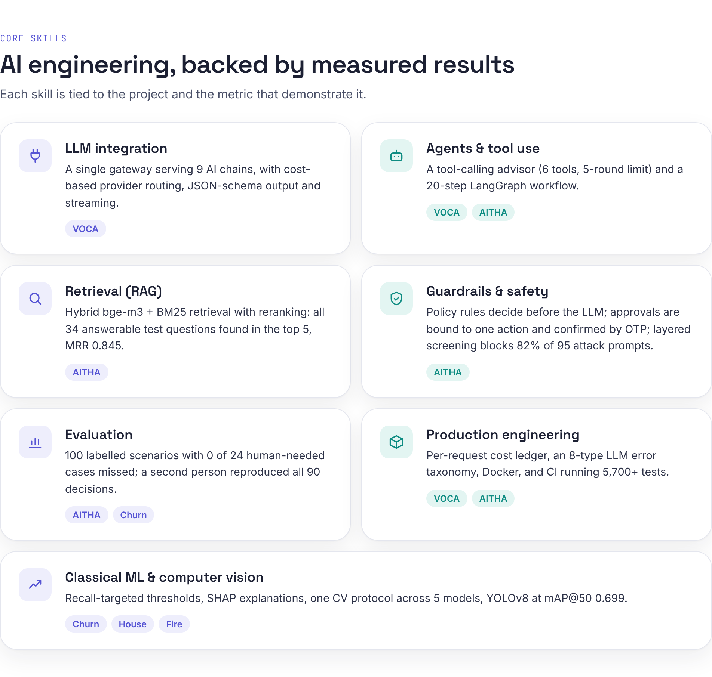
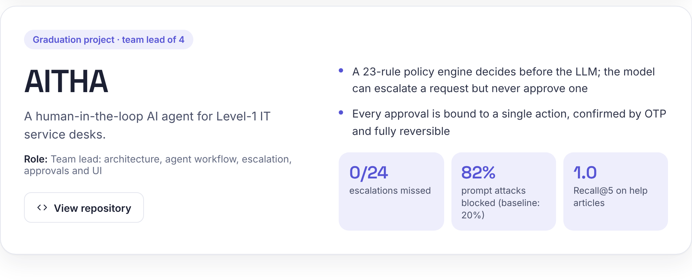
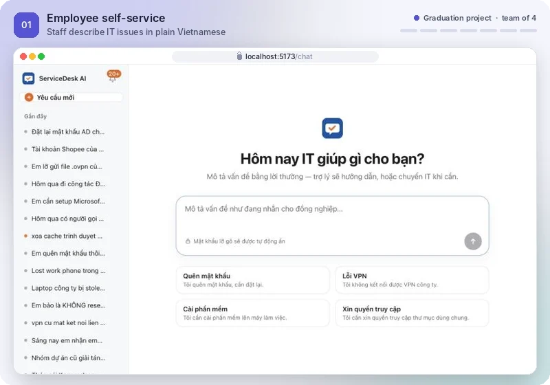
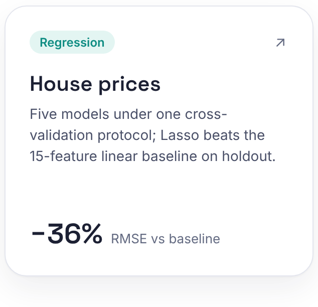
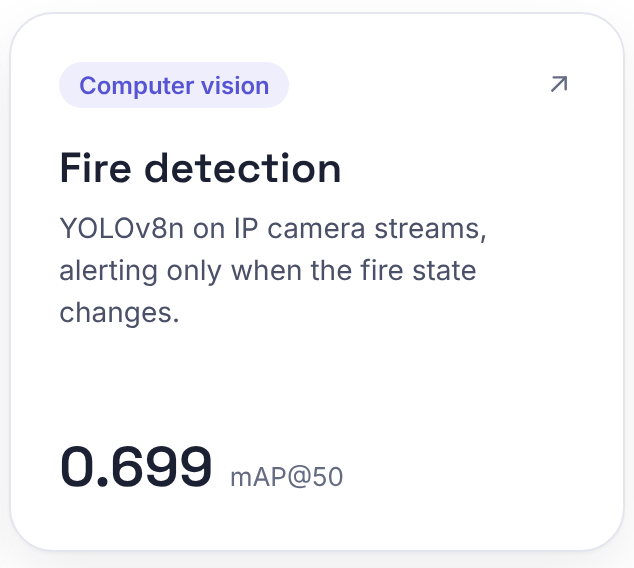
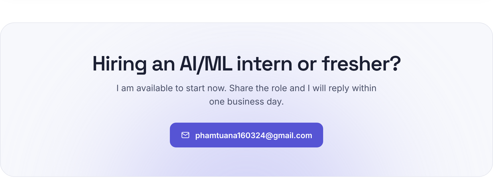

<picture><source media="(max-width: 600px) and (prefers-color-scheme: dark)" srcset="assets/readme/hero-m-dark.svg"><source media="(max-width: 600px)" srcset="assets/readme/hero-m.svg"><source media="(prefers-color-scheme: dark)" srcset="assets/readme/hero-dark.svg"></picture>

<a href="mailto:phamtuana160324@gmail.com"><picture><source media="(prefers-color-scheme: dark)" srcset="assets/readme/btn0-dark.webp"></picture></a>
<a href="https://www.voca.io.vn"><picture><source media="(prefers-color-scheme: dark)" srcset="assets/readme/btn1-dark.webp"></picture></a>

<picture><source media="(max-width: 600px) and (prefers-color-scheme: dark)" srcset="assets/readme/stack-m-dark.svg"><source media="(max-width: 600px)" srcset="assets/readme/stack-m.svg"><source media="(prefers-color-scheme: dark)" srcset="assets/readme/stack-dark.svg"></picture>

<picture><source media="(max-width: 600px) and (prefers-color-scheme: dark)" srcset="assets/readme/caps-m-dark.webp"><source media="(max-width: 600px)" srcset="assets/readme/caps-m.webp"><source media="(prefers-color-scheme: dark)" srcset="assets/readme/caps-dark.webp"></picture>

<a href="https://www.voca.io.vn"><picture><source media="(max-width: 600px) and (prefers-color-scheme: dark)" srcset="assets/readme/voca-m-dark.webp"><source media="(max-width: 600px)" srcset="assets/readme/voca-m.webp"><source media="(prefers-color-scheme: dark)" srcset="assets/readme/voca-dark.webp"></picture></a>

<a href="https://www.voca.io.vn"><picture><source media="(prefers-color-scheme: dark)" srcset="assets/readme/voca-tour-dark.webp"></picture></a>

<a href="https://github.com/17tuanphamanh/AIP_FA26_G8"><picture><source media="(max-width: 600px) and (prefers-color-scheme: dark)" srcset="assets/readme/aitha-m-dark.webp"><source media="(max-width: 600px)" srcset="assets/readme/aitha-m.webp"><source media="(prefers-color-scheme: dark)" srcset="assets/readme/aitha-dark.webp"></picture></a>

<a href="https://github.com/17tuanphamanh/AIP_FA26_G8"><picture><source media="(prefers-color-scheme: dark)" srcset="assets/readme/aitha-tour-dark.webp"></picture></a>

<a href="https://github.com/17tuanphamanh?tab=repositories"><picture><source media="(max-width: 600px) and (prefers-color-scheme: dark)" srcset="assets/readme/more-m-dark.webp"><source media="(max-width: 600px)" srcset="assets/readme/more-m.webp"><source media="(prefers-color-scheme: dark)" srcset="assets/readme/more-dark.webp"></picture></a>

<a href="https://github.com/17tuanphamanh/churn-explainable-ml"><picture><source media="(max-width: 600px)" srcset="assets/readme/blank.png"><source media="(prefers-color-scheme: dark)" srcset="assets/readme/card0-dark.webp"></picture></a><a href="https://github.com/17tuanphamanh/House-Price-Prediction-using-Linear-Regression"><picture><source media="(max-width: 600px)" srcset="assets/readme/blank.png"><source media="(prefers-color-scheme: dark)" srcset="assets/readme/card1-dark.webp"></picture></a><a href="https://github.com/17tuanphamanh/YOLOv8n-FireDetection"><picture><source media="(max-width: 600px)" srcset="assets/readme/blank.png"><source media="(prefers-color-scheme: dark)" srcset="assets/readme/card2-dark.webp"></picture></a>

<a href="https://github.com/17tuanphamanh?tab=repositories"><picture><source media="(prefers-color-scheme: dark)" srcset="assets/readme/btn-repos-dark.webp"></picture></a>

<picture><source media="(max-width: 600px) and (prefers-color-scheme: dark)" srcset="profile/activity-m-dark.svg"><source media="(max-width: 600px)" srcset="profile/activity-m.svg"><source media="(prefers-color-scheme: dark)" srcset="profile/activity-dark.svg"></picture>

<a href="mailto:phamtuana160324@gmail.com"><picture><source media="(max-width: 600px) and (prefers-color-scheme: dark)" srcset="assets/readme/footer-m-dark.webp"><source media="(max-width: 600px)" srcset="assets/readme/footer-m.webp"><source media="(prefers-color-scheme: dark)" srcset="assets/readme/footer-dark.webp"></picture></a>

Text version of this page

**Phạm Tuấn Anh**, final-year AI student at FPT University (2022–2026), Hanoi, Vietnam. Open to AI/ML Engineer intern and fresher roles.

I build production LLM applications, together with the evaluation, guardrails and cost controls that keep them reliable.

**VOCA**, live at [voca.io.vn](https://www.voca.io.vn): AI career guidance for Vietnamese high-school students. I built the AI layer, backend,
frontend and infrastructure: one LLM gateway behind 9 AI chains with cost-based routing and JSON-schema validation, a tool-calling advisor
agent (6 tools, 5-round limit), Redis pub/sub WebSockets, HMAC-verified payments and in-browser Whisper. Source is private; walkthrough on request.

**AITHA** ([repository](https://github.com/17tuanphamanh/AIP_FA26_G8)), graduation project, team lead of 4: a human-in-the-loop AI agent for Level-1 IT service desks.
A 23-rule policy engine decides before the LLM, approvals are bound to one action and confirmed by OTP. Results: 0 of 24 human-needed
cases missed in 100 labelled scenarios; 82% of 95 attack prompts blocked (Prompt Guard 2: 20%); 34 of 34 answerable questions found in
the top 5 (MRR 0.845); a second person reproduced all 90 decisions.

**Other projects:** [customer churn](https://github.com/17tuanphamanh/churn-explainable-ml) (PR-AUC 0.674, base rate 0.20),
[house prices](https://github.com/17tuanphamanh/House-Price-Prediction-using-Linear-Regression) (−36% holdout RMSE against a linear baseline),
[fire detection](https://github.com/17tuanphamanh/YOLOv8n-FireDetection) (YOLOv8n, mAP@50 0.699).

**Stack:** Python, FastAPI, LangGraph, LLM APIs (DeepSeek, Gemini, Claude), Hugging Face, Qdrant, bge-m3, scikit-learn, pandas, YOLOv8,
PostgreSQL, Redis, Docker, GitHub Actions, pytest, TypeScript.

Email: [phamtuana160324@gmail.com](mailto:phamtuana160324@gmail.com) · Live product: [voca.io.vn](https://www.voca.io.vn)

