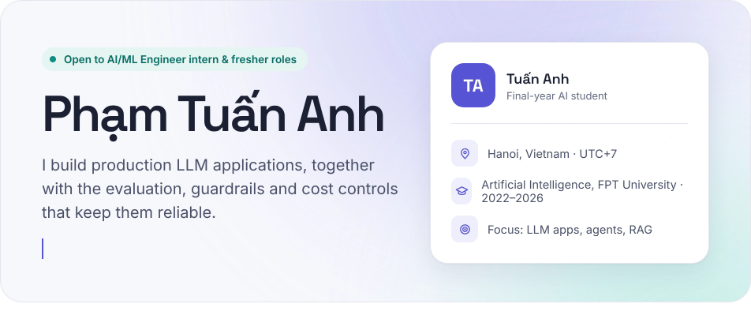
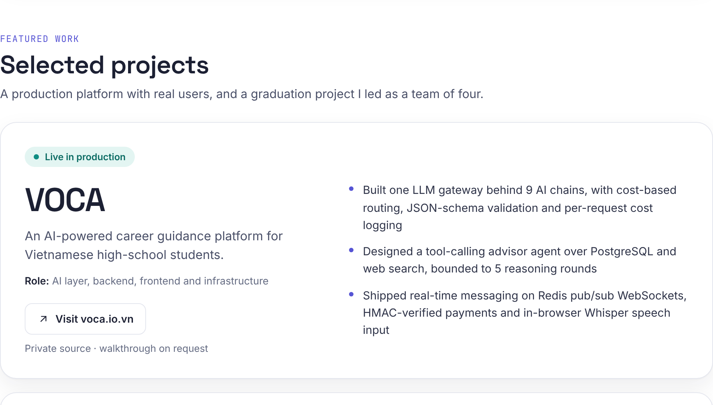
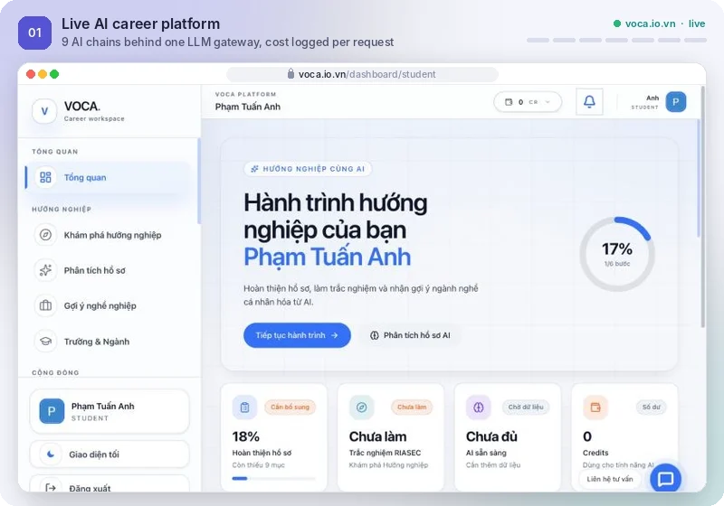
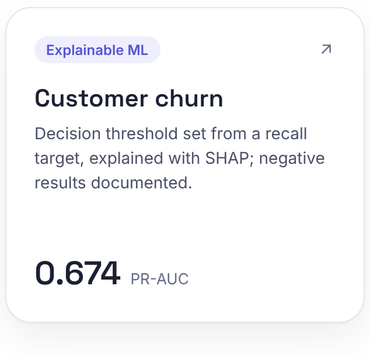
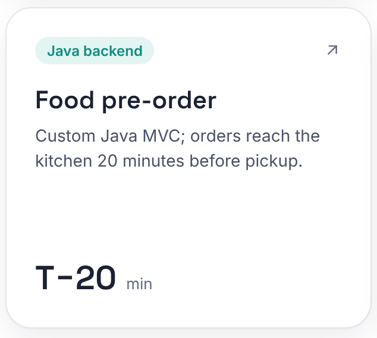
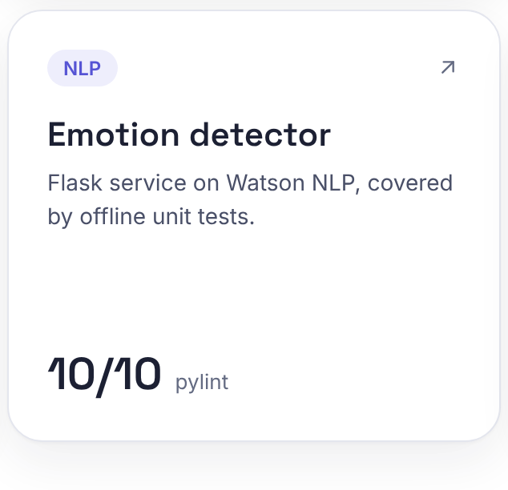
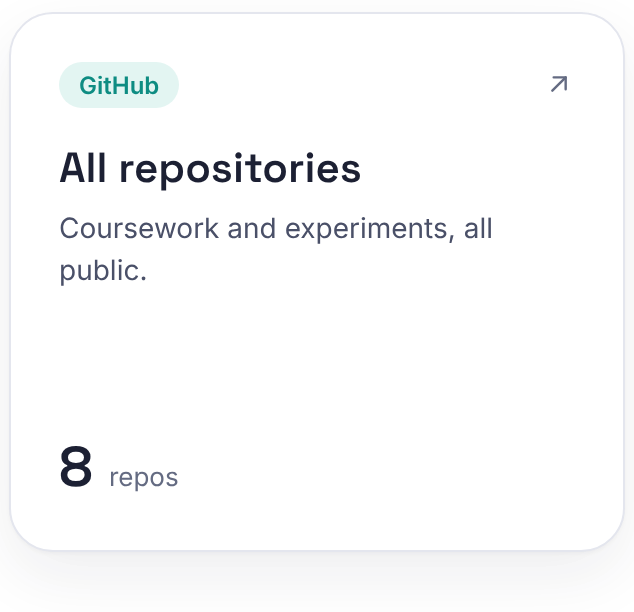

<picture>
  <source media="(prefers-color-scheme: dark)" srcset="assets/readme/hero-dark.svg">
  
</picture>

  <a href="mailto:phamtuana160324@gmail.com"><picture><source media="(prefers-color-scheme: dark)" srcset="assets/readme/btn0-dark.webp"></picture></a>
  <a href="https://www.voca.io.vn"><picture><source media="(prefers-color-scheme: dark)" srcset="assets/readme/btn1-dark.webp"></picture></a>

<picture>
  <source media="(prefers-color-scheme: dark)" srcset="assets/readme/stack-dark.svg">
  
</picture>

<picture>
  <source media="(prefers-color-scheme: dark)" srcset="assets/readme/caps-dark.webp">
  
</picture>

<a href="https://www.voca.io.vn"><picture>
  <source media="(prefers-color-scheme: dark)" srcset="assets/readme/voca-dark.webp">
  
</picture></a>

<a href="https://www.voca.io.vn"><picture>
  <source media="(prefers-color-scheme: dark)" srcset="assets/readme/voca-tour-dark.webp">
  
</picture></a>

<a href="https://github.com/17tuanphamanh/AIP_FA26_G8"><picture>
  <source media="(prefers-color-scheme: dark)" srcset="assets/readme/aitha-dark.webp">
  
</picture></a>

<a href="https://github.com/17tuanphamanh/AIP_FA26_G8"><picture>
  <source media="(prefers-color-scheme: dark)" srcset="assets/readme/aitha-tour-dark.webp">
  
</picture></a>

<picture>
  <source media="(prefers-color-scheme: dark)" srcset="assets/readme/more-dark.webp">
  
</picture>

<a href="https://github.com/17tuanphamanh/churn-explainable-ml"><picture><source media="(prefers-color-scheme: dark)" srcset="assets/readme/card0-dark.webp"></picture></a><a href="https://github.com/17tuanphamanh/House-Price-Prediction-using-Linear-Regression"><picture><source media="(prefers-color-scheme: dark)" srcset="assets/readme/card1-dark.webp"></picture></a><a href="https://github.com/17tuanphamanh/YOLOv8n-FireDetection"><picture><source media="(prefers-color-scheme: dark)" srcset="assets/readme/card2-dark.webp"></picture></a>

<a href="https://github.com/17tuanphamanh/swp301-block"><picture><source media="(prefers-color-scheme: dark)" srcset="assets/readme/card3-dark.webp"></picture></a><a href="https://github.com/17tuanphamanh/emotion-detector-watson-nlp"><picture><source media="(prefers-color-scheme: dark)" srcset="assets/readme/card4-dark.webp"></picture></a><a href="https://github.com/17tuanphamanh?tab=repositories"><picture><source media="(prefers-color-scheme: dark)" srcset="assets/readme/card5-dark.webp"></picture></a>

<picture>
  <source media="(prefers-color-scheme: dark)" srcset="profile/activity-dark.svg">
  
</picture>

<a href="mailto:phamtuana160324@gmail.com"><picture>
  <source media="(prefers-color-scheme: dark)" srcset="assets/readme/footer-dark.webp">
  
</picture></a>

