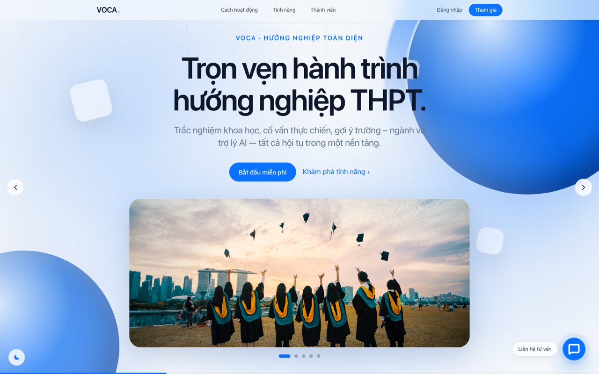
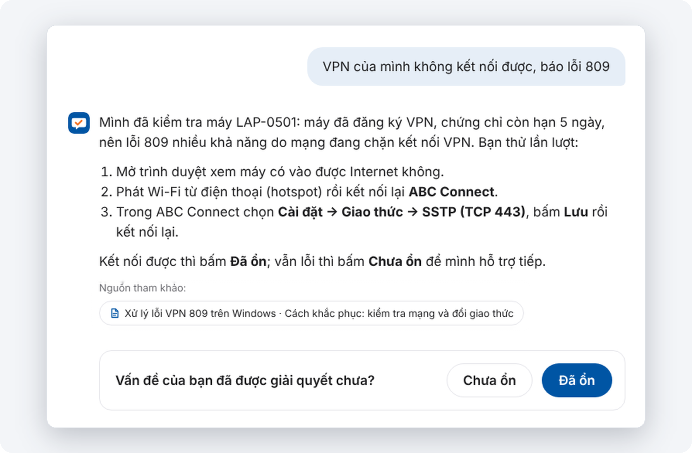

### Hi, I'm Tuấn Anh

I'm a final-year Artificial Intelligence student at FPT University in Hanoi (2022 – 2026). I submitted my graduation
project in November 2026 and I'm looking for a junior AI engineer or machine learning role, internship or full-time.
I can start right away.

Most of what I build puts LLMs inside real products. I built the AI side of [VOCA](https://www.voca.io.vn), a career
guidance platform that real users use, and I led the four-person team behind AITHA, an IT helpdesk agent, for my
graduation project.

**Email:** phamtuana160324@gmail.com &nbsp;·&nbsp; **Live project:** [voca.io.vn](https://www.voca.io.vn)

---

## VOCA: AI career guidance platform

[voca.io.vn](https://www.voca.io.vn) helps high-school students choose a career and a university major. It has
aptitude tests, an AI career advisor, school and major recommendations, and booking for sessions with mentors.
I worked on the AI layer, the backend, the frontend and the infrastructure.

The code is private because the site has real users. I'm happy to give access during an interview.

- **LLM gateway.** All nine AI chains go through one layer I wrote between the app and the model providers.
  High-volume calls go to DeepSeek, and the one call per session that really matters goes to Claude Opus.
  Every call is logged with tokens and cost per user, feature and model. Failures are sorted into eight types
  (auth, quota, rate limit, bad model, parse error and so on) and shown on the admin page. Before this, a broken
  API key fell back to mock answers without telling anyone.
- **Advisor agent.** The advisor calls six tools to look up occupations, majors, schools and the student's own
  profile and recommendations in PostgreSQL, plus a web search that has to cite its source. Text streams to the user while tools are
  still running, and the loop stops after five tool rounds so it can't burn through the token budget.
- **Structured output.** Model output is constrained by JSON schema, so the backend never has to parse free text.
- **Other parts:** Redis pub/sub so WebSocket messages reach users on any instance, SePay payments with
  HMAC-verified webhooks, Google Calendar sync over OAuth2, and speech-to-text with Whisper running in the browser.

`FastAPI` `PostgreSQL` `Redis` `Next.js` `TypeScript` `Docker`

---

## AITHA: AI agent for a Level-1 IT service desk

<a href="https://github.com/17tuanphamanh/AIP_FA26_G8">
  <picture>
    <source media="(prefers-color-scheme: dark)" srcset="assets/aitha-dark.png">
    
  </picture>
</a>

Graduation project, team of four, I was the team lead. [Source code](https://github.com/17tuanphamanh/AIP_FA26_G8) ·
[10 demo cases (PDF)](https://github.com/17tuanphamanh/AIP_FA26_G8/blob/main/docs/anh-demo/AITHA-anh-chup-demo-10-ca.pdf)

Employees write IT requests in Vietnamese: a VPN error, a forgotten password, a software install, access to a
shared folder. The agent checks their machine and the related systems, then answers from internal documents or
carries out the fix. Anything risky waits for a person to approve it. The main question of the project was how
the system decides when a human has to step in.

I owned the architecture, the LangGraph workflow, the escalation logic, approvals and execution, and the web UI.

- A policy of 23 rules runs before the LLM, the strictest matching rule wins, and the LLM cannot override it.
  Requests that no rule covers go to an LLM risk check, which for now is only allowed to escalate, never to approve.
- An approval is tied to a hash of one exact action, confirmed with an OTP, and can be rolled back.
- Prompt injection goes through three layers: fixed patterns, an XLM-RoBERTa classifier the team fine-tuned,
  and an LLM judge. Sensitive data is masked first.

What we measured, on simulated IT systems:

| Test | Result |
|---|---|
| 100 labelled scenarios | The LLM layer missed **0 of 24** cases that needed a human |
| 95 hand-written attack sentences, labelled blind | Caught **82%** (Meta's Prompt Guard 2 alone: 20%), 1 false alarm in 45 normal sentences |
| Retrieval over 34 help articles | Recall@5 **1.0**, MRR 0.845 |
| A second person re-ran the evaluation | **90 of 90** decisions matched |

We haven't shown yet that mixing rules with an LLM is cheaper than rules alone, and it hasn't run against real
company systems.

`Python` `LangGraph` `FastAPI` `PostgreSQL` `Qdrant` `bge-m3` `XLM-RoBERTa` `React` `Docker Compose`

---

## Smaller projects

| Project | What I did | Result |
|---|---|---|
| [Customer churn](https://github.com/17tuanphamanh/churn-explainable-ml) | Churn model for 10,000 bank customers. Picked the decision threshold from a recall target of 0.70 instead of using 0.5, and used SHAP to explain it. SMOTE didn't beat class weights, and I kept that result in the report. | Test PR-AUC 0.674, ROC-AUC 0.846 |
| [House prices](https://github.com/17tuanphamanh/House-Price-Prediction-using-Linear-Regression) | Compared five models on Kaggle House Prices with the same cross-validation setup. Two very large, cheap houses were wrecking the linear models; after dropping them from the training set, Lasso came out on top and XGBoost didn't. | Holdout RMSE 36% lower than the baseline |
| [Fire detection](https://github.com/17tuanphamanh/YOLOv8n-FireDetection) | Fine-tuned YOLOv8n for fire and smoke on IP cameras. Sends a Telegram alert with a photo only when the state changes, not on every frame. | mAP@50 0.699 |
| [Food pre-order](https://github.com/17tuanphamanh/swp301-block) | Java servlet app with hand-written MVC, no framework. Paid pre-orders are held and sent to the kitchen 20 minutes before pickup. | Integration tests for login, password reset and CSRF |
| [Emotion detector](https://github.com/17tuanphamanh/emotion-detector-watson-nlp) | Flask app on IBM Watson NLP. The unit tests mock the network call so they run offline. | pylint 10/10 |

---

## Skills

**Languages:** Python, TypeScript, Java, SQL 
**AI and ML:** LLM APIs (Anthropic, OpenAI, Gemini, DeepSeek), tool calling, structured output, LangGraph, RAG, scikit-learn, XGBoost, SHAP, YOLOv8, pandas 
**Backend:** FastAPI, SQLAlchemy, PostgreSQL, Redis, WebSocket, Qdrant, Java Servlet, SQL Server 
**Frontend:** Next.js, React, Tailwind CSS 
**Tools:** Docker, GitHub Actions, pytest, Playwright, Vercel, Render, Sentry

---

**Contact:** phamtuana160324@gmail.com · Hanoi, Vietnam
